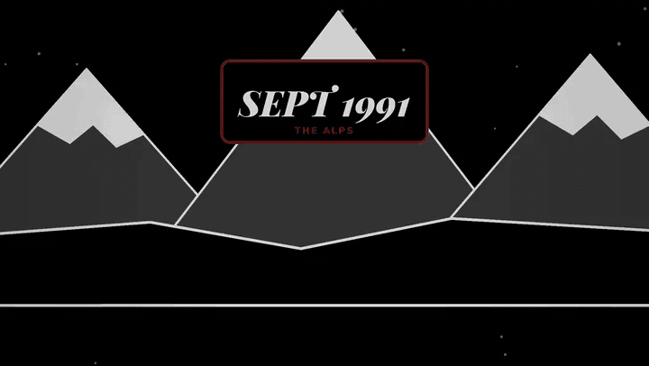
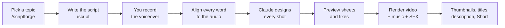

# Stick Animation Studio (Claude Code plugin)



*Frames from "The 5,300-Year-Old Murder: Ötzi the Iceman", a 10-minute video made start to finish with this plugin.*

This free plugin turns Claude into a faceless YouTube studio. You record the voiceover, and Claude does the rest:

**topic ideas → retention-first script (open loops, natural voice) → aligned, hand-designed stick-figure animation (16:9 or 9:16) → StoryScene thumbnails → titles, description and tags → a hook Short.**

## How it works



1. **Script.** Claude pitches 10 ideas in your niche and writes a ~1,750-word script in a natural storyteller voice. It uses *open loops* (questions planted early and paid off later) to keep people watching, and it sticks to documented facts with theories flagged.
2. **Voiceover.** You record the script in your own voice, or with any text-to-speech tool, and hand Claude the MP3.
3. **Alignment.** An offline speech recogniser (PocketSphinx) finds when every word is spoken. The narration is cut into shots of about 5 seconds at sentence boundaries.
4. **Scene design.** Claude writes each shot as a small piece of code: the setting, stick figures with poses and expressions, props, maps, counters and on-screen text. Every animation is timed to the exact word it illustrates (`at: 'w:arrowhead'`). It's not stock footage or AI video: every frame is drawn from code, so it's consistent, sharp and editable.
5. **QC.** Contact sheets show one still per shot. Claude checks them for overlaps, off-screen text and errors, and fixes problems before rendering.
6. **Render.** A headless browser draws every frame on a canvas. ffmpeg encodes the frames in parallel and adds a generated music bed that dips under your voice, sound effects, and a final mix at −14 LUFS (YouTube's loudness target).
7. **Package.** StoryScene thumbnails (a key scene with a red arrow on the clue), A/B variants, a phone-size feed preview, titles, a description with timestamps and sources, tags, and a standalone 9:16 hook Short.

Your brand comes from one file, `channel.json`: the logo text, accent colour, tagline, voice and house rules. Change it and every video, end card and thumbnail follows.

## 5-minute quickstart
1. **Install the plugin.** In Claude Code, run:
   ```
   /plugin marketplace add daboadvertising/stick-animation-studio
   /plugin install stick-animation-studio@stick-animation-studio
   ```
2. **Set up the engine:** run `/stick-animation-studio:setup`. It checks Python, Node and ffmpeg, then installs the speech aligner and the built-in renderer (headless Chromium). Everything is included: there's nothing else to download by hand.
   Projects go in `~/stick-studio` (change it with `STICK_WORKSPACE`); finished videos land in `~/stick-studio/deliveries/`.
3. **Brand it:** run `/stick-animation-studio:channel` to set your name, logo split, accent colour, tagline and house rules (saved to `channel.json`).
4. **Make a video:**
   - `/stick-animation-studio:scriptforge` picks a niche, gives 10 ideas and writes a short script.
   - `/stick-animation-studio:script` writes the ~1,750-word extended script and the Shorts hook.
   - Record the voiceover, then run `/stick-animation-studio:animate` with your MP3 and the script.
   - `/stick-animation-studio:thumbnails` and `/stick-animation-studio:package` produce the thumbnails, titles, description and tags.
   - Record the hook, then run `/stick-animation-studio:short`.

## What's inside
| Folder | Contents |
|---|---|
| `skills/` | stick-animation-studio (pipeline), scriptforge, extended-script, open-loops, shorts-hook, animate, storyscene-thumbnails |
| `commands/` | the slash commands above |
| `engine/` | `ss.py` CLI, `runtime/` (our own renderer: canvas engine, stick-figure rig, frame player, Chromium→ffmpeg encoder), `audio.py` (generated music bed, sound effects, ducking, −14 LUFS master), the kit (scene engine and prop libraries: ancient, Bronze Age, Greece, Rome, India, Alps, tech, modern…), the thumbnail renderer, prompts, ENGINE_REFERENCE and PROP_INDEX |
| `examples/` | finished shot files and specs to learn from |
| `setup/setup.sh` | environment check and installer |

## Requirements
- Python 3.9+, Node 18+ and ffmpeg
- About 1 GB of disk
- Rendering takes about 3–4 minutes per minute of video on a laptop CPU

## Honest notes
- Scripts use real, documented accounts only. Theories are flagged. Always check the sources before you publish.
- Nobody can guarantee views or click-through. The plugin builds variants for YouTube Test & Compare.

## Licence
Free and open source under the **MIT licence** (see `LICENSE`). Use it, change it, share it, make money with the videos you create.
Bundled fonts (Fredoka, Nunito, Playfair Display) are under the SIL Open Font License; see `engine/runtime/fonts/`.
